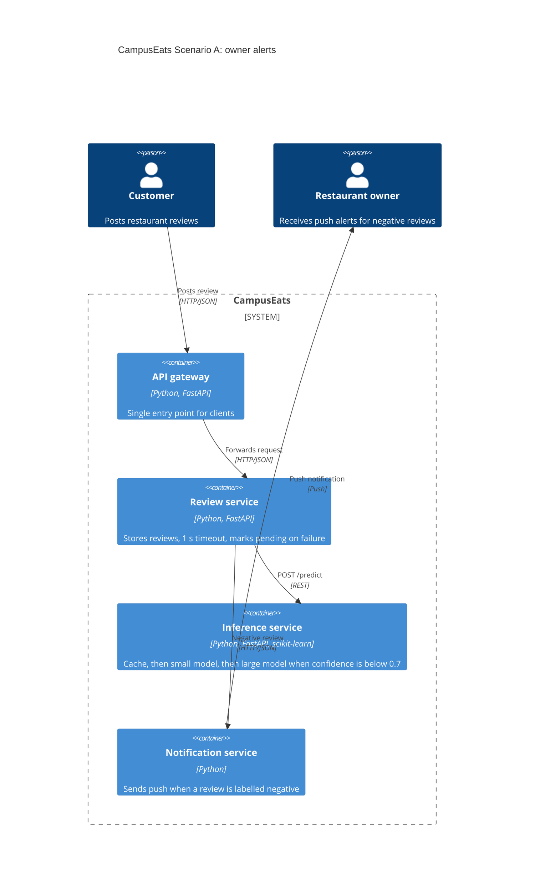

# Task 4: Deployment topologies and trade-offs

**Name / ชื่อ:** ธนกร ไชยยุทธ

**Student ID / รหัสนิสิต:** 6631321321

This is **individual work**: each student completes and submits their own copy, in their own fork.

_งานนี้เป็น**งานเดี่ยว** นิสิตแต่ละคนทำและส่งงานของตัวเอง ใน fork ของตัวเอง_

**Scenario (A, B or C) / Scenario ที่เลือก:** A

Choose **one** scenario below. If the last digit of your student ID is odd, take A or B; if it is even, take B or C. Use your measurements from Tutorial 6 as evidence: cite run names from `results/runs.csv`. Answer in Thai or English.

เลือก scenario **หนึ่ง** ข้อด้านล่าง ถ้าเลขตัวสุดท้ายของรหัสนิสิตเป็นเลขคี่ ให้เลือก A หรือ B ถ้าเป็นเลขคู่ ให้เลือก B หรือ C ใช้ผลการวัดจาก tutorial ที่ทำไปเป็นข้อมูลอ้างอิง โดยอ้างชื่อ run จาก `results/runs.csv` จะตอบเป็นภาษาไทยหรือภาษาอังกฤษก็ได้

Facts that hold in every scenario / ข้อเท็จจริงที่ใช้กับทุก scenario:

- The large model serves at most **20 calls per second** (4 calls at once × about 200 ms each), and every call costs money.

  _large model รับได้สูงสุด **20 calls ต่อวินาที** (พร้อมกัน 4 calls × ประมาณ 200 ms ต่อ call) และทุก call มีค่าใช้จ่าย_

- The small model is fast and cheap enough to run anywhere, including inside the review service or on a kiosk, but it is much less accurate on its own.

  _small model เร็วและถูกพอที่จะรันที่ไหนก็ได้ รวมถึงภายใน review service หรือบน kiosk แต่ถ้าใช้ตัวเดียวจะแม่นน้อยกว่ามาก_

## Scenarios

**A. Owner alerts.** When a customer posts a negative review, the restaurant owner gets a push notification within **2 seconds**. At the lunch peak, CampusEats receives **40 reviews per second**. A missed alert is acceptable, but a wrong alert (for example, "your customer is unhappy" when they are happy) makes owners stop trusting alerts and, in the end, ignore them.

_เมื่อลูกค้าโพสต์รีวิวเชิงลบ เจ้าของร้านจะต้องได้รับ push notification ภายใน **2 วินาที** เวลาช่วงพีคตอนเที่ยง CampusEats ได้รับรีวิวจำนวน **40 รายการต่อวินาที** การพลาด alert ไปบ้างนั้นยอมรับได้ แต่ alert ที่ผิด (เช่น "ลูกค้าไม่พอใจ" ทั้งที่จริงๆ แล้วพอใจ) จะทำให้เจ้าของร้านไม่เชื่อถือและเลิกสนใจ alert ในที่สุด_

## Topologies and patterns to choose from / Topology และ pattern ที่เลือกใช้ได้

|     | Topology                        | Where the model runs / โมเดลรันที่ไหน                                                                                                           |
| --- | ------------------------------- | ----------------------------------------------------------------------------------------------------------------------------------------------- |
| T1  | Model as a service, synchronous | Inference service, called for each review (today's baseline) _inference service ถูกเรียกทุกรีวิว (baseline ของวันนี้)_                       |
| T2  | Model as a library              | Inside the review service, or on the device _ภายใน review service หรือบนอุปกรณ์_                                                             |
| T3  | Hybrid                          | Small model locally, large model as a remote service _small model รันในเครื่อง large model เป็น remote service_                              |
| T4  | Asynchronous / batch            | Reviews are queued (broker, W10) or stored, and scored later in bulk _รีวิวถูกเข้าคิว (broker, W10) หรือเก็บไว้ แล้วติด label ทีหลังเป็นชุด_ |

Combine one topology with any of the patterns from Tutorial 6: **fallback**, **cascade** and **cache**.

_เลือก topology หนึ่งแบบ แล้วผสมกับ pattern จาก Tutorial 6 ได้ตามต้องการ: **fallback**, **cascade** และ **cache**_

## 1. Quality requirements

The three most important quality requirements for your scenario, each with a number where possible.

_quality requirements ที่สำคัญที่สุด 3 ข้อของ scenario ที่เลือก ระบุตัวเลขเมื่อทำได้_

| #   | Quality                   | Requirement                                                                                                                                                     |
| --- | ------------------------- | --------------------------------------------------------------------------------------------------------------------------------------------------------------- |
| 1   | Performance (latency)     | เจ้าของร้านได้รับ push notification ภายใน 2 วินาทีหลังลูกค้าโพสต์รีวิว                                                                                          |
| 2   | Capacity / Cost           | ที่พีค 40 รีวิวต่อวินาที ต้องเรียก large model ไม่เกิน 20 calls ต่อวินาที (คือไม่เกิน 50% ของรีวิว) และเรียกให้น้อยที่สุดเพราะทุก call มีค่าใช้จ่าย             |
| 3   | Accuracy (trust in alert) | alert ที่ส่งต้องเชื่อถือได้ ใช้เกณฑ์ accuracy อย่างน้อย 90% ตาม QR3 ยอมให้พลาด alert บางรายการ (pending) ได้ แต่ห้ามส่ง alert ผิดจากการที่โมเดลทายพลาดมากเกินไป |

## 2. Design / การออกแบบ

Your topology, the patterns you add, and a container-level diagram (C4 level 2). The C4 diagram must be written in Mermaid.

_topology ที่เลือก pattern ที่เพิ่ม และ diagram ระดับ container (C4 level 2) เขียนด้วย Mermaid_

**Topology:** T1 (model as a service, synchronous) ผสม 3 patterns ได้แก่ **cascade** (threshold 0.7), **cache** และ **fallback** (timeout 1 วินาที)

- ทุกรีวิวผ่าน cache ก่อน ถ้าเจอคำตอบเดิมก็ตอบทันที
- ถ้าไม่เจอ ถาม small model ถ้า confidence ≥ 0.7 ใช้คำตอบนั้น ถ้าไม่ถึงจึงส่งต่อไป large model
- ถ้า inference service ช้าหรือค้างเกิน 1 วินาที review service บันทึกรีวิวเป็น `pending` แล้วไม่ส่ง alert (ยอมพลาด alert ได้ตาม scenario)
- เมื่อได้ label เป็น `negative` เท่านั้น จึงส่งต่อให้ notification service

## 3. Evidence / หลักฐาน

Which runs support your choice? Show the numbers and, for scenario A, the capacity arithmetic: how many large-model calls per second does your design need at the peak?

_run ไหนที่สนับสนุนการตัดสินใจของนิสิต ให้นิสิตแสดงตัวเลขประกอบ และสำหรับ scenario A ให้นิสิตแสดงการคำนวณ capacity ด้วย เพื่อแสดงว่าในช่วงพีคนั้น design ของนิสิตต้องใช้ large model กี่ calls ต่อวินาที_

| Run      | What it shows / แสดงอะไร                                                                                                                     |
| -------- | -------------------------------------------------------------------------------------------------------------------------------------------- |
| t0-large | ส่งทุกรีวิวไป large model (100% large calls) ที่พีค 40 × 100% = 40 calls/s เกินเพดาน 20 calls/s สองเท่า จึงใช้ไม่ได้                         |
| t0-small | small model อย่างเดียวเร็ว (p50 33 ms) แต่ accuracy แค่ 72.5% ต่ำกว่า 90% จึงเสี่ยงส่ง alert ผิดบ่อย                                         |
| t2-0.7   | cascade ที่ 0.7 ได้ accuracy 93.0% และ large calls 53% ที่พีค 40 × 0.53 = 21.2 calls/s ยังเกินเพดานเล็กน้อย จึงต้องมี cache เพิ่ม            |
| t3-cache | cascade 0.7 + cache: accuracy 93.0%, large calls 38%, cache hits 35%, p95 529 ms ที่พีค 40 × 0.38 = **15.2 calls/s** ต่ำกว่าเพดาน 20 calls/s |
| t1-after | เมื่อ large model ค้าง (hang-rate 0.1) fallback ทำให้ errors เป็น 0 และรีวิวที่ pending 19 รายการยังถูกบันทึก p95 1019 ms ยังอยู่ใน 2 วินาที |

**Capacity arithmetic (พีค 40 รีวิวต่อวินาที):**

- ใช้ large model อย่างเดียว: 40 × 100% = 40 calls/s (เกิน 20)
- cascade 0.7 อย่างเดียว: 40 × 53% = 21.2 calls/s (เกินเล็กน้อย)
- cascade 0.7 + cache (`t3-cache`): 40 × 38% = **15.2 calls/s** (ผ่าน เหลือ margin ประมาณ 24% ของเพดาน 20)

**ข้อจำกัดของหลักฐาน:** cache hit rate 35% มาจากชุดข้อมูลทดสอบที่มีข้อความซ้ำ ข้อมูลจริงอาจต่ำกว่านี้ ที่ cascade 0.7 ลำพังใช้ large 53% ถ้าต้องการให้ผ่านเพดาน 20 calls/s ต้องมี cache hit อย่างน้อยประมาณ 6% (ประมาณจากสัดส่วนคูณกัน) หรือลด threshold ลง (`t2-0.6` ใช้ large 38% แต่ accuracy 91.5% เฉียดเกณฑ์ 90%) นอกจากนี้ยังไม่ได้วัด precision ของ alert โดยตรง (วัดแค่ accuracy รวม) และ p95 ของ `t1-after` (1019 ms) เกิน 1 วินาทีของ QR1 เดิม แต่ยังอยู่ในเกณฑ์ 2 วินาทีของ scenario นี้

## 4. ADR

Use the ADR format from W5.

_ใช้รูปแบบ ADR จาก W5_

**Title:** ใช้ model as a service ร่วมกับ cascade, cache และ fallback สำหรับ alert รีวิวเชิงลบที่ช่วงพีค 40 รีวิวต่อวินาที

**Status:** Proposed

**Context:** เจ้าของร้านต้องได้ push notification ภายใน 2 วินาทีเมื่อมีรีวิวเชิงลบ ช่วงพีคมี 40 รีวิวต่อวินาที แต่ large model รับได้สูงสุด 20 calls ต่อวินาทีและทุก call มีค่าใช้จ่าย การพลาด alert ยอมรับได้ แต่ alert ที่ผิดทำให้เจ้าของร้านเลิกเชื่อถือ alert การใช้ large model อย่างเดียว (`t0-large`) ต้องใช้ 40 calls/s เกินเพดาน ส่วน small model อย่างเดียว (`t0-small`) ได้ accuracy แค่ 72.5%

**Decision:** ใช้ T1 (model as a service, synchronous) ผสม cache, cascade ที่ threshold 0.7 และ fallback ที่ timeout 1 วินาที รีวิวที่ได้ label เป็น negative จะถูกส่งไป notification service ส่วนรีวิวที่ pending จะไม่ส่ง alert และให้ติด label ทีหลัง

**Consequences:**

- Positive: ที่พีคใช้ large model ประมาณ 15.2 calls/s (`t3-cache`) ต่ำกว่าเพดาน 20 calls/s, accuracy 93.0% ผ่านเกณฑ์ 90%, p95 529 ms ต่ำกว่า 2 วินาที, ถ้า large model ค้าง ระบบไม่ล้ม (errors 0 ใน `t1-after`) และ cost ลดลงเพราะเรียก large model แค่ 38% ของรีวิว
- Negative: accuracy ต่ำกว่า large อย่างเดียว 0.5 จุด (93.5% เหลือ 93.0%), margin ของ capacity ขึ้นกับ cache hit rate ซึ่งอาจต่ำกว่า 35% ในข้อมูลจริง, small model อาจมั่นใจผิดกับประโยคปฏิเสธหรือประโยคที่มี "but" ทำให้ alert ผิดได้ และเมื่อเปลี่ยน large model ต้องล้าง cache หรือใส่เวอร์ชันโมเดลใน key

**Alternatives considered:** at least one topology you rejected, and why.

_อย่างน้อยหนึ่ง topology ที่ไม่เลือก และเหตุผล_

> - **T1 ใช้ large model อย่างเดียว (ไม่มี pattern):** ที่พีคต้องใช้ 40 calls/s เกินเพดาน 20 calls/s (`t0-large`) และมีค่าใช้จ่ายสูงสุด จึงไม่เลือก
> - **T2 small model อย่างเดียว (model as a library):** เร็วและถูก (`t0-small` p50 33 ms) แต่ accuracy 72.5% ต่ำกว่า 90% ทำให้ส่ง alert ผิดบ่อย ซึ่งทำลายความเชื่อถือของเจ้าของร้าน จึงไม่เลือก
> - **T4 asynchronous / batch:** ติด label เป็นชุดทีหลังจึงทำให้ push notification ภายใน 2 วินาทีไม่ได้ จึงไม่เลือก
> - **T3 hybrid (small model รันใน review service):** ช่วยลด network hop ได้ แต่ต้อง deploy และดูแลโมเดลในอีก service หนึ่ง และไม่มีผลวัดรองรับในแล็บนี้ จึงยังไม่เลือก อาจพิจารณาภายหลังถ้า latency กลายเป็นปัญหา
